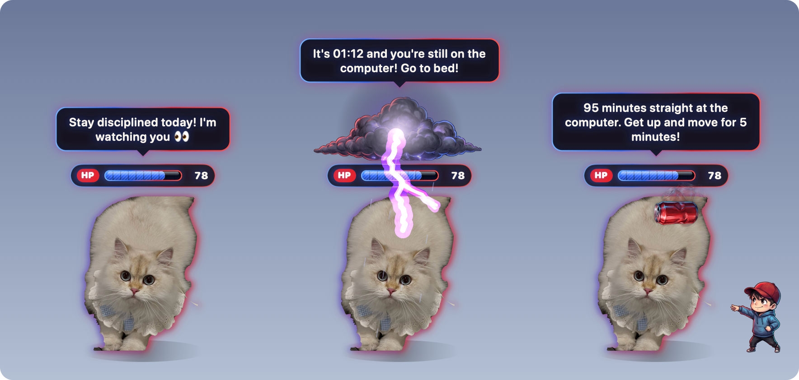
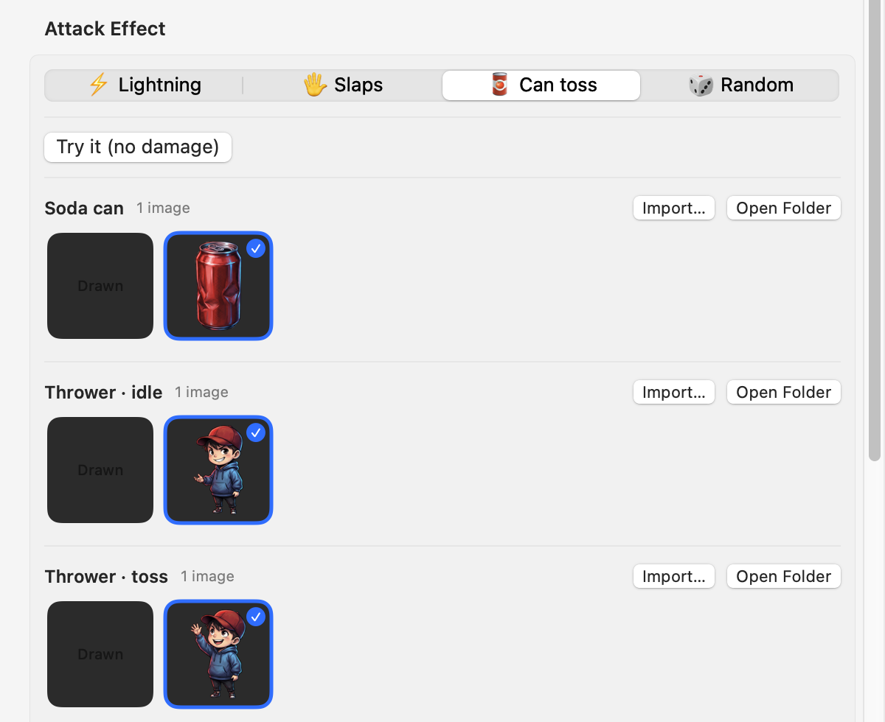
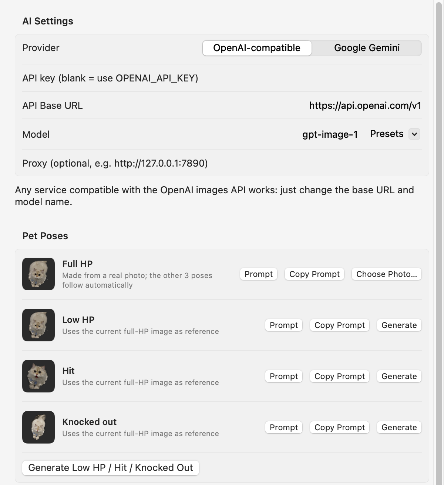
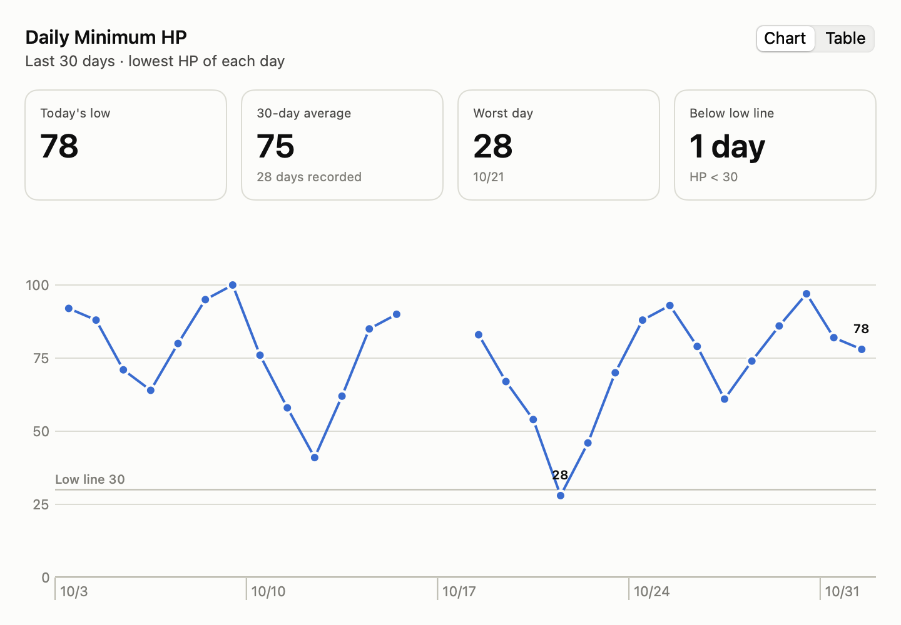

# DeskPet 🐣

**A desktop pet that keeps you disciplined.** Turn a photo into a cartoon character that lives on your desktop with an HP bar over its head. Your bad habits become attacks on it: stay up past curfew or sit at the computer too long and it gets struck by lightning, slapped, or bonked with a soda can. Get a proper night's sleep and it heals.

[中文说明](README.zh-CN.md)

<p align="center">
  
</p>

| Platform | Status | Tech |
|---|---|---|
| **macOS** 14+ | ✅ Full feature set | Swift · SwiftUI · AppKit ([details](mac/README.md), 中文) |
| **Windows** 10/11 | 🚧 Everything except the lingering post-attack effects | Tauri 2 · Rust · HTML/JS ([details](windows/README.md), 中文) |

## Features

- **Desktop pet**: a transparent, always-on-top character with a comic-style HP bar. Drag it anywhere, double-click to poke it, right-click for quick actions. Your HP sits in the menu bar or system tray.
- **Habit rules** (all adjustable):
  | Rule | Default |
  |---|---|
  | Using the computer during curfew | −2 HP per active minute, 00:00–06:00 |
  | Sitting too long | after 90 min of continuous use, −1 HP per minute until you take a 5-min break |
  | A clean night | +30 HP the next morning |
- **Attack combos** with a choice of effect: ⚡️ lightning from a storm cloud, 🖐️ a flurry of slaps, 🥫 a can thrown by a kid who juggles it while waiting, or 🎲 random. HP drops hit by hit, with hit-flash, shake, damage numbers and comic bursts.
- **Pose art** for full HP, low HP, getting hit and knocked out. Missing poses fall back to filters (greyed out, tipped over, tinted red).
- **Asset library**: every image is kept in a fixed folder per type, so you can switch between versions any time or drop new images into the folder.
- **HP dashboard**: daily minimum HP over the last 30 days.
- **AI generation**: make the character from a photo and generate the other poses and effect art with OpenAI-compatible image APIs or Google Gemini. Prompts are editable, and there's a "copy prompt" option for using a web app instead.
- **Config import/export**, **launch at login**, **Chinese / English** UI.

## Screenshots

Screenshots from the macOS version; the Windows version has the same pages.

| Pick an attack effect; its art expands below | Generate the character and effect art with AI |
|---|---|
|  |  |

**HP dashboard**: the lowest HP of each day over the last 30 days (sample data).



## Download

| Platform | Download | Requirements |
|---|---|---|
| **macOS** | [**DeskPet-macOS.zip**](https://github.com/jinfenglin/nightowl-pet/releases/latest/download/DeskPet-macOS.zip) | macOS 14 or later, Apple Silicon (M1 or newer) |
| **Windows** | [**DeskPet-Windows-setup.exe**](https://github.com/jinfenglin/nightowl-pet/releases/latest/download/DeskPet-Windows-setup.exe) | Windows 10/11, 64-bit |

These links always point to the newest version. Older versions and release notes are on the [Releases page](https://github.com/jinfenglin/nightowl-pet/releases).

**macOS, first launch.** The app isn't notarized by Apple, so macOS blocks it the first time:
1. Unzip and drag **DeskPet.app** into **Applications**.
2. Open it. When macOS says it can't verify the app, go to **System Settings → Privacy & Security**, scroll down and click **Open Anyway**.
   Or run this once in Terminal: `xattr -dr com.apple.quarantine /Applications/DeskPet.app`

DeskPet has no Dock icon: it lives on your desktop and in the menu bar (❤️ HP).

**Windows, first launch.** The installer isn't code-signed, so SmartScreen may show "Windows protected your PC". Click **More info → Run anyway**. It installs for the current user, so no admin rights are needed.

### Publishing a release

Push a version tag and GitHub Actions builds both apps and publishes the release in about 20 minutes:
```bash
git tag v0.1.0
git push origin v0.1.0
```
Every push to `main` also builds both apps; those test builds are under **Actions → Build** (run artifacts, kept 90 days).

## Build from source

### macOS
Requires the Xcode Command Line Tools (full Xcode not needed).
```bash
cd mac
./build_app.sh                          # builds DeskPet.app
./DeskPet.app/Contents/MacOS/DeskPet    # or move DeskPet.app to /Applications
```

### Windows
Requires [Rust](https://rustup.rs) with the Visual Studio C++ Build Tools. WebView2 ships with Windows 10/11.
```powershell
cargo install tauri-cli --version "^2" --locked
cd windows\src-tauri
cargo tauri dev      # run in development
cargo tauri build    # installer in target\release\bundle\nsis\
```
The Windows version also runs on macOS for development: `cd windows/src-tauri && cargo build && ./target/debug/deskpet`.

## Repository layout

```
assets/defaults/   built-in art shared by both apps: pet/<pose>.png, fx/<effect>.png
mac/               native macOS app (Swift Package + build_app.sh)
windows/           Windows app (Tauri: src-tauri/ in Rust, ui/ in plain HTML/CSS/JS)
.github/workflows/ builds both apps; publishes releases on version tags
```

Both apps use the same data formats: the asset-library layout (`Library/pet/<pose>/`, `Library/fx/<effect>/`), the daily HP file (`hp_history.json`) and the same setting names.

## Where your data lives

| | macOS | Windows |
|---|---|---|
| Assets, HP history | `~/Library/Application Support/DeskPet/` | `%APPDATA%\DeskPet\` |
| Settings | `defaults read com.deskpet.app` | `%APPDATA%\DeskPet\settings.json` |

## Privacy

Everything runs locally. DeskPet only reads how long it's been since your last keyboard or mouse input (no keystrokes or screen content), and it needs no special permissions for that. Images and prompts leave your computer only when you use AI generation, and then only to the provider you configured. API keys are stored in the local settings above.

## Roadmap (Windows)

- [x] Phase 1: pet window, HP, rules, tray, settings, default art, launch at login, Chinese/English
- [ ] Phase 2: lingering threats after an attack (cloud stays and flickers, kid juggles the can), richer particle effects
- [x] Phase 3: asset generation page with OpenAI / Gemini
- [x] Phase 4: config import/export (same file format as macOS)

## Credits

The built-in art in `assets/defaults/` was supplied by the project author: the cat poses are cut-out photos, and the effect art (storm cloud, can, thrower kid) was generated with Google Gemini.

## License

No license has been chosen yet. Until one is added, all rights are reserved.
